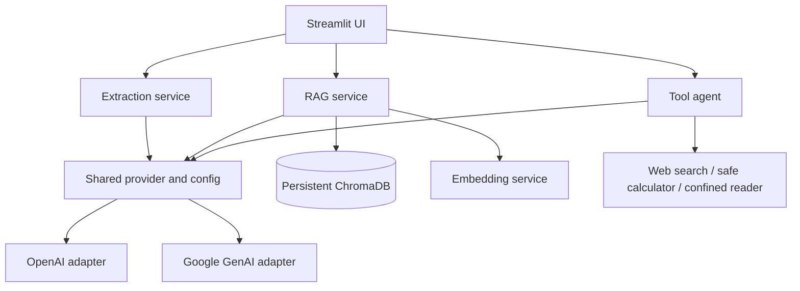

# NexaMind

From Knowledge to Reasoning to Action.

## GenAI Engineering Workbench

Four independently testable GenAI services share configuration, provider adapters, exceptions, and logging. Python 3.11+, uv, Pydantic v2, OpenAI, Google GenAI, ChromaDB, and Streamlit are used.

## Architecture



## Setup

```powershell
cd F:\genai-engineering
uv sync
Copy-Item .env.example .env
# Set OPENAI_API_KEY or GEMINI_API_KEY in .env
```

The generation provider is selected with `LLM_PROVIDER=openai|gemini`. RAG embeddings are selected independently with `EMBEDDING_PROVIDER=openai|gemini|sentence_transformers`. OpenAI and Gemini use their provider APIs. The local Sentence Transformers adapter is an optional dependency:

```powershell
uv sync --extra local-embeddings
# In .env:
# EMBEDDING_PROVIDER=sentence_transformers
# EMBEDDING_MODEL=sentence-transformers/all-MiniLM-L6-v2
# EMBEDDING_DEVICE=cpu
```

The local model is downloaded by Sentence Transformers on first use. API credentials are not needed for local embedding. No credentials are needed for unit tests.

Scanned PDFs and image OCR are opt-in. Enable `OCR_ENABLED=true` and install Tesseract with the selected language data; see [deployment and operations](docs/deployment.md). Durable chat history is also opt-in with `CHAT_PERSISTENCE_ENABLED=true`; set `CHAT_DATABASE_PATH` to a protected local path.

## Run

```powershell
uv run streamlit run app/streamlit_app.py
uv run python scripts/run_extraction.py invoice data/samples/sample_invoice.txt
uv run python scripts/ingest_documents.py data/samples/sample_invoice.txt data/samples/sample_resume.txt
uv run python scripts/run_agent.py "Calculate sqrt(144) and explain the result"
docker compose up --build -d
uv run python scripts/run_rag_evaluation.py --chunk-sizes 500 900 --overlaps 80 120 --top-k-values 3 5 --thresholds 0.1 0.2
```

## Design notes

- Invoice and resume extraction use strict Pydantic models and bounded repair prompts. Missing values remain null or empty collections.
- PDF pages are split independently so page citations stay accurate. The recursive splitter uses configurable chunk size and overlap: larger chunks carry more context but can dilute retrieval; overlap reduces boundary loss at the cost of duplicated tokens and storage.
- Ingestion supports text PDFs/TXT and opt-in OCR for scanned PDFs and PNG/JPEG images. Set `OCR_ENABLED=true`; install the Tesseract executable and its requested language pack separately, then configure `OCR_LANGUAGE` (default `eng`) and optional `TESSERACT_CMD`. Upload byte, page-count, and decoded-image pixel limits apply; page metadata records whether text extraction or OCR produced it.
- Chroma persists vectors; content hashes and page offsets provide stable chunk IDs and duplicate protection. Similarity scores are ranking signals, not proof of truth.
- Each Chroma collection records its embedding provider, model, revision, and dimension. Populated legacy collections without that fingerprint are rejected. Re-embed them into a fresh collection with `uv run python scripts/migrate_embeddings.py --source-collection old --target-collection new`, verify it, then set `CHROMA_COLLECTION=new`; the source remains intact.
- The agent exposes only three validated tools. Calculator expressions use a restricted AST; file reads are confined to `ALLOWED_FILE_ROOT`. Search results and file text are treated as untrusted.
- Streamlit session state holds conversation history; RAG storage remains separate and persistent.

## Tests and style

```powershell
uv run pytest
uv run ruff check .
uv run ruff format --check .
```

Tests use deterministic local doubles and do not make API calls. Live API use is opt-in through credentials and explicit CLI/UI actions. Set request timeout and bounded retries with environment settings. Never commit `.env`.

See [RAG evaluation](docs/evaluation.md) for the curated test cases, configuration matrix runner, report generation, and API cost controls.

An explicitly enabled OpenAI smoke test is available with `RUN_LIVE_TESTS=1`; it is skipped by default and may incur API charges.

See [docs/engineering-report.md](docs/engineering-report.md) for the verified deliverables, QA results, and current limits.
The final technical summary, architecture, test record, security assessment,
configuration, and provider integration guide are in
[docs/final-technical-report.md](docs/final-technical-report.md),
[docs/architecture.md](docs/architecture.md),
[docs/testing-report.md](docs/testing-report.md),
[docs/security-review.md](docs/security-review.md),
[docs/configuration.md](docs/configuration.md), and
[docs/provider-guide.md](docs/provider-guide.md).

## Limitations

Gemini tool calling and OCR depend on the optional external Tesseract executable and language data. The Streamlit app runs locally and does not provide durable chat persistence beyond the session.
