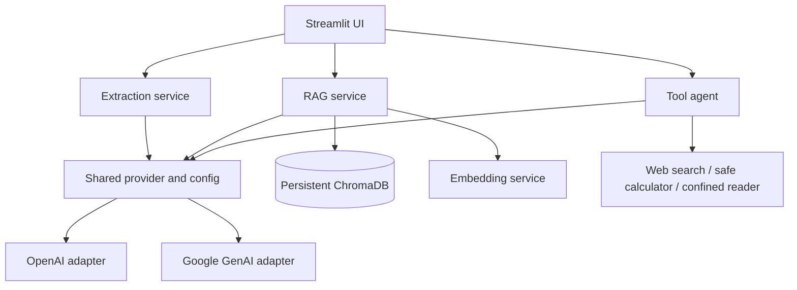

# NexaMind

From Knowledge to Reasoning to Action.

## GenAI Engineering Workbench

Four independently testable GenAI services share configuration, provider adapters, exceptions, and logging. Python 3.11+, uv, Pydantic v2, OpenAI, Google GenAI, ChromaDB, and Streamlit are used.

## Architecture



## Setup

```powershell
cd F:\genai-engineering
uv sync
Copy-Item .env.example .env
# Set OPENAI_API_KEY or GEMINI_API_KEY in .env
```

The provider is selected with `LLM_PROVIDER=openai|gemini`. Extraction and RAG generation work with either provider. Native agent tool calling currently uses OpenAI; embeddings currently use OpenAI. No credentials are needed for unit tests.

## Run

```powershell
uv run streamlit run app/streamlit_app.py
uv run python scripts/run_extraction.py invoice data/samples/sample_invoice.txt
uv run python scripts/ingest_documents.py data/samples/sample_invoice.txt data/samples/sample_resume.txt
uv run python scripts/run_agent.py "Calculate sqrt(144) and explain the result"
```

## Design notes

- Invoice and resume extraction use strict Pydantic models and bounded repair prompts. Missing values remain null or empty collections.
- PDF pages are split independently so page citations stay accurate. The recursive splitter uses configurable chunk size and overlap: larger chunks carry more context but can dilute retrieval; overlap reduces boundary loss at the cost of duplicated tokens and storage.
- Chroma persists vectors; content hashes and page offsets provide stable chunk IDs and duplicate protection. Similarity scores are ranking signals, not proof of truth.
- The agent exposes only three validated tools. Calculator expressions use a restricted AST; file reads are confined to `ALLOWED_FILE_ROOT`. Search results and file text are treated as untrusted.
- Streamlit session state holds conversation history; RAG storage remains separate and persistent.

## Tests and style

```powershell
uv run pytest
uv run ruff check .
uv run ruff format --check .
```

Tests use deterministic local doubles and do not make API calls. Live API use is opt-in through credentials and explicit CLI/UI actions. Set request timeout and bounded retries with environment settings. Never commit `.env`.

An explicitly enabled OpenAI smoke test is available with `RUN_LIVE_TESTS=1`; it is skipped by default and may incur API charges.

See [docs/engineering-report.md](docs/engineering-report.md) for the verified deliverables, QA results, and current limits.

## Limitations

OCR is not included for scanned PDFs. Embedding generation requires OpenAI credentials. Gemini tool calling is not yet wired into the agent adapter. The Streamlit app runs locally and does not provide durable chat persistence beyond the session.
