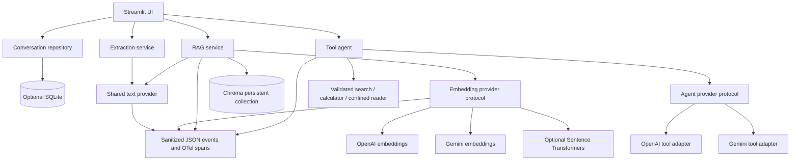

# Architecture and data flow

## Components

## RAG ingestion and query

1. The ingestion boundary checks extension, file signature where applicable,
   byte count, PDF page count, and image/rendered-page pixel limits.
2. PyMuPDF extracts page text. When OCR is enabled, low-text image-based PDF pages
   and supported raster images go through Tesseract. Page number and extraction
   method flow into chunk metadata.
3. The chunker assigns stable source-content/page/offset IDs. The configured
   embedding adapter batches the text and validates vector dimensions.
4. Chroma persists the vectors and collection fingerprint (provider, model,
   revision, dimension, metadata version, cosine space). Existing incompatible or
   fingerprint-free collections fail closed. Migration re-embeds into a new
   collection and leaves the source intact.
5. Queries are embedded through the same adapter, filtered by score threshold,
   and passed to grounded generation with source/page context. Citations are
   returned alongside the answer.

## Agent flow

The agent owns one execution loop and one Pydantic schema per tool. Provider
adapters map shared tool definitions/messages to OpenAI or Gemini request formats
and normalize tool calls back to a common record. The loop validates each argument,
executes only the allowlisted tool, returns observations, and stops at iteration
and total-call limits. Tool traces contain status and elapsed time. Provider
streaming emits text tokens while tool progress is sent to the Streamlit UI.

## Conversation data

Messages remain in Streamlit session state when persistence is off. When enabled,
the SQLite repository stores conversation/message IDs, roles, content, timestamps,
provider/mode metadata, and owner scope. Every read/write/delete checks owner ID.
An optional trusted authentication-proxy header plus deployment secret derives a
stable HMAC owner ID; absent that configuration, each Streamlit session uses a
random in-memory owner ID.

## Evaluation and observability

The evaluation runner indexes the curated fixture set into separate collections
for chunk size/overlap and evaluates top-k/threshold settings. Embedding and answer
providers are selected from environment settings. Answer generation is separately
opt-in because it can incur charges. The report script scores saved runs and emits
JSON and Markdown. Token/phrase measures are lexical proxies, not semantic judges.

Provider calls, embeddings, retrieval, and tool operations emit sanitized JSON
events with request ID, provider/model where known, status, timing, and token counts
when available. OpenTelemetry spans use the standard API; no external exporter is
configured by default.
