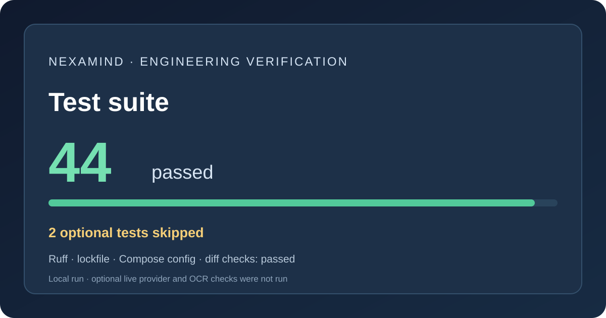

# Testing report

Date: 2026-11-04

## Local checks

The final suite and formatting checks were run after M6–M11 changes.

- `uv run pytest -q`: **44 passed, 2 skipped**, with 34 ChromaDB/Pydantic
  deprecation warnings. Skips are the opt-in OpenAI live test and real Tesseract
  integration test. Tests use mocked providers and local fixtures.
- `uv run ruff check .`: passed.
- `uv run ruff format --check .`: passed.
- `uv lock --check`: passed with 177 resolved packages.
- `uv run python scripts/run_rag_evaluation.py --help`: passed.
- `uv run python scripts/report_evaluation.py --help`: passed.
- `docker compose config`: passed.
- `pip-audit` over the locked runtime export: passed with three narrowly scoped
  Chroma advisory IDs ignored. Details and rationale are in
  [security-review.md](security-review.md).

## Test coverage

- Embedding adapters, batching, dimensions, query/document task types, and provider
  selection use deterministic fakes.
- OCR fallback, extraction metadata, format/size/page/pixel bounds, and failure
  behavior use mocked OCR and generated PDF/image fixtures.
- OpenAI/Gemini agent adapters, malformed calls, total-call budget, validation,
  tool execution status/duration, and streaming callbacks use mock SDK responses.
- Evaluation metrics, report aggregation, observability sanitization, and SQLite
  owner isolation/restart lookup have local tests.
- The live OpenAI smoke test and `RUN_OCR_TESTS=1` Tesseract integration test are
  skipped by default.

## Not executed locally

- No paid OpenAI or Gemini requests.
- No real Sentence Transformers model download/inference.
- No real Tesseract run because the external OCR executable/language data were not
  installed in this environment.
- No Docker image build or container HTTP smoke test: Docker Desktop's image store
  is on the system drive, which had no free space. CI now contains a container
  build and health-endpoint job; that remote job has not run from this workspace.

Do not treat unexecuted live, OCR, or container checks as passed.
